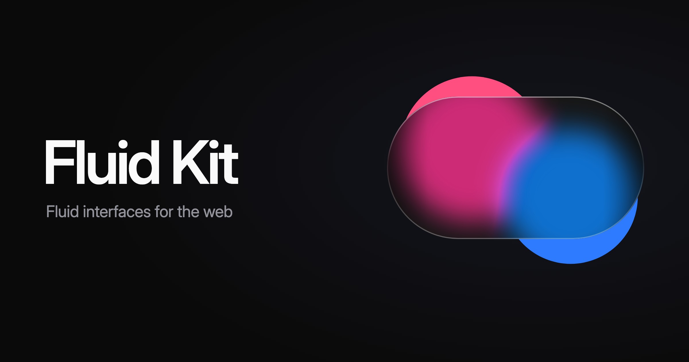

<p align="center">
  <a href="https://fluidkit.mogilnikov.dev">
    
  </a>
</p>
<p align="center">
  <a href="https://github.com/mikhailmogilnikov/fluid-kit/blob/main/LICENSE"></a>
  <a href="https://www.npmjs.com/package/@fluidkit/core"></a>
  <a href="https://www.npmjs.com/package/@fluidkit/core"></a>
  <a href="https://github.com/mikhailmogilnikov/fluid-kit/actions/workflows/ci.yml"></a>
</p>

## Why Fluid Kit?

Fluid Kit brings the interactions of iOS 26 to the web. Liquid Glass is plain CSS, and the rest is what makes iOS feel fluid: a button that grows into a panel, a long press that lifts a photo and opens its menu, sheets you flick, a highlight that follows the finger, lists that make room. Every motion runs on a spring that keeps its speed when you change your mind. It's headless and works on any element, with no framework or with compound components for React, Vue and Svelte (`Lift.Root`, `Lift.Menu`, …).

- **Liquid Glass in plain CSS**: blur, fill, rims and press effects as classes, glass that melts between shapes, in Safari, Chrome and Firefox
- **Springs that keep their speed**: interrupt any motion and it turns from where it is, as fast as it was going, which CSS transitions can't do
- **Interactions, not primitives**: morphs, context menus, sheets, indicators and layout animations, tuned against iOS 26
- **Any element, any framework**: headless engines underneath, components and hooks on top; your markup, your styles, state in data attributes
- **Accessible**: keyboard and focus handled, reduced motion and reduced transparency respected
- **Only what you use**: one package for your framework, tree-shaken, nothing else to install

## Packages

| Package | Description |
| --- | --- |
| [`@fluidkit/react`](https://www.npmjs.com/package/@fluidkit/react) | Components and hooks for React 18+, and everything in core |
| [`@fluidkit/vue`](https://www.npmjs.com/package/@fluidkit/vue) | Components and composables for Vue 3.5+, and everything in core |
| [`@fluidkit/svelte`](https://www.npmjs.com/package/@fluidkit/svelte) | Components and runes for Svelte 5.29+, and everything in core |
| [`@fluidkit/core`](https://www.npmjs.com/package/@fluidkit/core) | Every feature without a framework, the spring they share, and the stylesheet |

All four come out together, at the same version.

## Getting Started

Visit [fluidkit.mogilnikov.dev](https://fluidkit.mogilnikov.dev) to get started.

```bash
npm install @fluidkit/react
```

```tsx
import "@fluidkit/react/style.css";
import { Lift } from "@fluidkit/react";

// Long-press the photo: it lifts above the page and its menu opens beside it
export function Photo({ src }: { src: string }) {
  return (
    <Lift.Root onSelect={(value) => console.log(value)}>
      <Lift.Target render={} />
      <Lift.Menu className="menu lb">
        <Lift.Item value="copy">Copy</Lift.Item>
        <Lift.Item value="share">Share</Lift.Item>
      </Lift.Menu>
    </Lift.Root>
  );
}
```

## What's Inside

| Feature | What it does |
| --- | --- |
| [Liquid Blur](https://fluidkit.mogilnikov.dev/blur) | A glass material in plain CSS: press effects, and glass that melts between nearby shapes |
| [Morph](https://fluidkit.mogilnikov.dev/morph) | One element grows into another and back, its matching parts flying between them |
| [Indicator](https://fluidkit.mogilnikov.dev/indicator) | One element that moves to whatever is hovered, pressed or selected: menus, tabs, segmented controls |
| [Drag](https://fluidkit.mogilnikov.dev/drag) | Rubber-band edges and snap points chosen by the flick: sheets, swipe actions, switches |
| [Lift](https://fluidkit.mogilnikov.dev/lift) | The iOS context menu: a long press lifts anything above the page and opens your menu |
| [Layout](https://fluidkit.mogilnikov.dev/layout) | Elements move to their new places when the page changes: lists, grids, sections that open |
| [Scroll Edge](https://fluidkit.mogilnikov.dev/edge) | Scrolling content fades out under the bars, only where there's more to scroll |
| [Motion](https://fluidkit.mogilnikov.dev/motion) | Apple's springs and transitions by name, for every feature and for CSS |

## Who Is This For?

Fluid Kit is a good fit if you are building:

- **Web apps that should feel native**: PWAs and app-like sites, on iPhone first
- **Interfaces with character**: iOS-grade motion without writing springs and gesture math yourself
- **Design systems**: headless engines to build your own components on, in any framework
- **Landing pages**: glass and motion that hold up in every browser
- **Any stack**: React, Vue, Svelte, or plain TypeScript and CSS

## Compared To

| Library | How Fluid Kit differs |
| --- | --- |
| **Motion** (Framer Motion) | Motion animates whatever you describe; Fluid Kit ships the interactions themselves, and works the same in React, Vue, Svelte and without a framework |
| **Liquid glass libraries** | Most draw refraction with SVG filters that only Chromium renders; Fluid Kit's glass is CSS that holds up in Safari and Firefox, with press effects and melting groups |
| **Vaul** | A React drawer; Fluid Kit's Drag moves any element in any framework, with rubber-band edges and snap points chosen by the flick |
| **View Transitions** | Cross-fade snapshots of two states; Fluid Kit morphs the live elements, and a morph can turn back mid-way |

## Documentation

- **Docs**: [fluidkit.mogilnikov.dev](https://fluidkit.mogilnikov.dev)
- **Playground**: [fluidkit.mogilnikov.dev/playground](https://fluidkit.mogilnikov.dev/playground), every hard case live, slowed down, with its boxes drawn
- **Changelog**: [fluidkit.mogilnikov.dev/changelog](https://fluidkit.mogilnikov.dev/changelog)

## Community

Found a bug, or missing something iOS does? [Open an issue](https://github.com/mikhailmogilnikov/fluid-kit/issues/new/choose). Built something with Fluid Kit? Show it there too.

## Contributing

Contributions are always welcome! See [CONTRIBUTING.md](CONTRIBUTING.md) for how the repository is laid out, how to run it, and how releases work.

## License

[MIT](LICENSE) © Mikhail Mogilnikov
